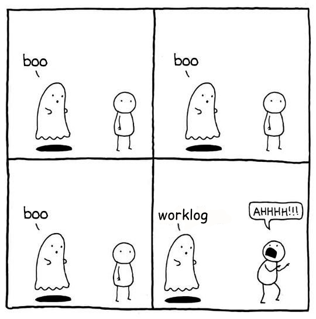
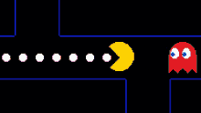

=============
B-Open Haunts
=============

\  

.. image:: https://img.shields.io/pypi/v/haunts.svg
        :target: https://pypi.python.org/pypi/haunts

.. contents:: Table of Contents

What it does
============

Fill Google Calendars with events taken from a Google Spreadsheet. Or the other way around.

How to install
==============

.. code-block:: bash

   pip install haunts

Prerequisites
=============

To use Google Calendar and Google Spreasheet APIs you must generate a Google API application and download a *credentials.json*:

* Run ``haunts --config``. It will create the ``~/.haunts`` folder and an ``haunts.ini`` file inside it.
* Edit the ``haunts.ini`` file by setting the ``CONTROLLER_SHEET_DOCUMENT_ID``
* Go to https://console.cloud.google.com/home/dashboard and create a Project called *haunts*.
  
  * In the search bar, search *Credentials APIs and services* and enable it.
  * Click on *Create Credentials > OAuth client ID*, set *Desktop* as the *type* and save the json file as ``~/.haunts/credentials.json``.
  * In the search bar, search *Google Sheets API* and *Google Calendar API* and activate them.
  
* Run ``haunts`` normally.
  It will ask you to authenticate to both the Google Sheets and the Google Calendar APIs (a browser should be automatically opened for you).
  This action will create the following files: ``~/.haunts/calendars-token.json`` and ``~/.haunts/sheets-token.json``

How to use
==========

Command line help is accessible using:

.. code-block:: bash

   haunts --help

Usage by examples
-----------------

To sync every available entry in a sheet named "May": 

.. code-block:: bash

   haunts May

To limits sync to events on a limited set of days:

.. code-block:: bash

   haunts --day=2021-05-24 --day=2021-05-25 --day=2021-05-28 May

To also limits sync to some projects (calendars):

.. code-block:: bash

   haunts --day=2021-05-24 --day=2021-05-25 --day=2021-05-28 --project="Project X" May

To execute only on rows where a "delete" action is defined (see "Actions" below):

.. code-block:: bash

   haunts --day=2021-05-24 --day=2021-05-25 --day=2021-05-28 --project="Project X" -a D May

To get the report instead of running calendar sync:

.. code-block:: bash

   haunts --execute report --day=2021-05-24 --day=2021-05-25 --day=2021-05-28 --project="Project X" May

To just report overtime entries in the set:

.. code-block:: bash

   haunts --execute report --day=2021-05-24 --day=2021-05-25 --day=2021-05-28 --project="Project X" --overtime May

To *read* today events from all configured calendar and write them on your "May" sheet for the current:

.. code-block:: bash

   haunts --execute read May

To *read* events for a specific date from all configured calendar and write them on your "May" sheet for the current:

.. code-block:: bash

   haunts --execute read -d 2023-05-15 May

How it works
------------

What haunts does depends on the ``--execute`` parameter.

In its default configuration (if ``--execute`` is omitted, or equal to ``sync``), the command will try to access a Google Spreatsheet you must have access to (write access required), specifically: it will read a single sheet at time inside that spreadsheet.
Every row inside this sheet is an event that will be also created on a Google Calendar.

Alternatively you can provide:

- ``--execute report``.
  
  In this case it just access the Google Spreadsheet to collect data.
- ``--execute read``.
  
  In this case it fills the Google Spreadsheet for you, by *reading* you calendars.

Sheet definition
----------------

The referenced sheet must contains a set of columns. Headers names are important but orders matters not.
Any additional columns will be ignored.

An `example sheet
<https://docs.google.com/spreadsheets/d/18ADhaNhEyr05cyNqXU-o-V4ialrzW9CS3XiFLM-glT4/edit#gid=998726384>`_ is provided.

The partition in multiple sheets is designed to keep every month in a separate sheet, but this is not strictly checked.

Every sheet must contains following headers (you can customize names in the ``haunts.ini`` file, providing ``<UPPERCASE-DEFAULT>_COLUMN_NAME`` entries. As example: ``START_TIME_COLUMN_NAME=Begin at``):

**Date**
  (date)
  
  The day where the event will be created. If the date is not found, the line will be treated as an empty line (so: skipped)

**Start time**
  (time string in format ``HH:MM`` or empty) - *optional column*
  
  If provided, the current event will start at given time. This will influence also events defined after this row

**Spent**
  (number or empty)
  
  How long the event will last. Leave empty to create a full-day event.
  
  When executing the report, full day event length is influences by ``OVERTIME_FROM`` configuration option

**Project**
  (string)
  
  Project name as it's named in the *config* sheet (see below)

**Activity**
  (string)
  
  Summary of the event

**Details**
  (string, optional)
  
  Additional text for the event description

**Event id**
  (string)
  
  Leave this empty. It will be filled with the id of the generated event

**Link**
  (text)
  
  Leave this empty. It will be filled with a link to the event inside Google Calendar

**Action**
  (chars)
  
  See below. If empty: it will be filled with an ``I`` when an event is created from this row

Configuring projects
~~~~~~~~~~~~~~~~~~~~

The spreadsheet must also contains a *configuration sheet* (default name is ``config``, can be changed in the .ini) where you must put at least two columns (with same headers as follows):

**id**
  The id of a Google Calendar associated to this project.
  You must have write access to this calendar.

**name**
  The name of the project, like a human readable name for a calendar.
  A project name can be associated to the same calendar id multiple times (this way you can have aliases).

**read_from** (optional)
  Used only for ``--execute read``.

  Read events from this (optional) calendar id instead of the canonical one (the one defined in the ``id`` column).
  This makes possible to *read* events from a calendar, but store them in another ones.

  It can also reference a Proton calendar, using the ``proton:<calendar id>`` format
  (see "Proton Calendar support" below).

Values in the ``name`` column are valid values for the ``Project`` column introduced above.

Proton Calendar support
-----------------------

``--execute read`` can also read events from `Proton Calendar <https://proton.me/calendar>`_, in addition to Google Calendar.

Proton provides no public API (calendar data is end-to-end encrypted), so *haunts* relies on
`proton-cli <https://proton-cli.lerchster.dev/>`_, an unofficial command line client:

* `Install proton-cli <https://proton-cli.lerchster.dev/install/>`_ (version 5.4.0 or later) and log in once with ``proton account login``
* Enable Proton support in ``haunts.ini`` by setting the ``PROTON_CLI`` option to the proton-cli executable name or path
  (``PROTON_CLI=proton``). Optionally, set ``PROTON_PROFILE`` to use a specific proton-cli profile
* If your Proton address is not ``USER_EMAIL``, set ``PROTON_EMAIL`` (comma separated, if you have more than one)
* In the config sheet, put ``proton:<calendar id>`` in the ``read_from`` column of the project that should collect events from a Proton calendar.
  Get calendar ids by running ``proton calendar settings calendars list --output json``

When enabled:

* Events from Proton calendars referenced in the config sheet are added to the related project.
  Like any other ``read_from`` calendar, ``Event id`` and ``Action`` are left empty, so a later ``sync`` will copy them to the Google Calendar of the project
* Events from any other Proton calendar (like invitations you accepted) are added with the project of their organizer,
  when the organizer is a Google calendar listed in the config sheet (``id`` or ``read_from`` column, the latter taking precedence).
  This happens when a Google calendar of your organization invites you.
  Otherwise they are added with the ``???`` project.
  Holidays calendars are ignored (unless explicitly referenced in the config sheet)
* When reading from both Google and Proton, Proton events that are copies of an event already read from Google
  (same iCalendar UID, like invitations sent by Google) are skipped
* Cancelled events are ignored
* Like for Google Calendar, only events you are (maybe) attending are read: events you organize, or where you accepted,
  answered "maybe" or not answered yet the invitation. Events you declined, or where you are not invited, are ignored.
  Events without attendees are always read
* The ``Link`` column is filled with a ``proton:<calendar id>/<event id>`` reference, used to not add the same event twice
* proton-cli version is checked at the beginning (``proton -v``): with a version older than 5.4.0
  a warning is printed, and events you declined are not skipped
* If proton-cli is not installed or you are not logged in, the command fails without writing anything.
  Use ``--skip proton`` to read from Google Calendar only (see below)

Choosing services to read from
------------------------------

By default ``--execute read`` reads from both Google Calendar and Proton Calendar (when ``PROTON_CLI`` is set).
Use the ``READ_FROM_SERVICES`` option in ``haunts.ini`` to choose services to read from, as a comma separated list
of ``google`` and ``proton``. For example, to read from Proton Calendar only:

.. code-block:: ini

   READ_FROM_SERVICES=proton

When ``READ_FROM_SERVICES`` explicitly includes ``proton``, ``PROTON_CLI`` is required.

Services can also be excluded for a single run with ``--skip`` (can be provided multiple times):

.. code-block:: bash

   haunts --execute read --skip proton May
   haunts --execute read --skip google May

Note that Google Sheets and Google Calendar credentials are still needed: the sheet is always on Google, and ``sync`` writes events on Google Calendar.

How events will be filled
-------------------------

Let says you run something like this:

.. code-block:: bash

   haunts --day=2021-07-08 July

*haunts*  will access the sheet named ``July`` in the spreadsheet configured in the .ini file.
Only rows where the ``Date`` filed will match the ``--day`` parameter will be considered (if this param is not provided: the full sheet content is analyzed).

For every rows that match, *haunts* will:

- Generate a new event, starting from a default time (this can be configured in the .ini).
  The event will last for ``Spent`` hours
- The next event will start where the previous ended
- If the event will be successfully created, an "I" will be placed in the ``Action`` column.
  This will make future executions to ignore the line.
- Other columns will be read or filled as described above.

Actions
-------

Possible values you can find (or type yourself) in the ``Action`` column:

- ``I``
  
  *ignore*: execution will just ignore this line. This is commonly automatically filled by haunts itself, but you can add this value manually to ignore the line. Example: for events you already have on calendar but you want to track on the spreadsheet too.
- ``II``
  
  *ignore all*: same as ``I``, but also ignore rows in the ``--execute=report`` mode
- ``D``
  
  *delete*: execution will clear ``Action``, ``Event id`` and ``Link`` cells for this row, and delete the related event on the Google Calendar.
  As also ``Action`` is cleared, next execution will likely fill this line again. Use this as a poor-man-edit, to change something on the event.

When syncing a calendar (``--execute=sync``) you can use this column to filter on which rows execute sync by providing the ``--action`` option. For example:

.. code-block:: bash

   haunts --action D July

This will sync only rows where the "Action" column contains the delete (``D``) value.

Reporting feature
-----------------

Using ``haunts -e report <SHEET_NAME>`` will read the source Spreadsheet to collect statistical data.

Both ``-p`` and ``-d`` parameters are allowed.

The resulting table can be something like the following::

   Date        Project      Total
   ----------  ---------  -------
   2022-11-20  Calendar1        2
   2022-11-20  Calendar2        1
   2022-11-21  Calendar2        5
   2022-11-21  Calendar3        3
   2022-11-23  Calendar1       10
   2022-11-24  Calendar1        8
   2022-11-26  Calendar4        9
   2022-11-27  Calendar4        8
   2022-11-27  Calendar5        1
   ----------  ---------  -------
                               47

For every calendar and day found in the sheet, it report a total of hours spent.

Full day events are taken into account, and the overwork is also supported by configuring both ``OVERTIME_FROM`` (default is: no overwork support) and ``WORKING_HOURS`` (default is: 8).

If you want to report overtime, you can use the ``--overtime`` flag, and only overtime rows will counted.

TODO and known issues
=====================

* rows in the sheet must be sorted ascending
* *haunts* will not check for already filled time slots (yet?), so overlapping of events may happens
* ``-e report`` is calculating values on Python side, you know… we have a more reliable spreadsheet there
* ``-e report`` is counting overtime based on "Start time" column, while it's probably better to read start dates from events

Why?!
=====

In `B-Open
<https://www.bopen.eu/>`_ this is how we register our worklogs, participation to projects in multiple Google Calendars.

OK, but why "haunts"?!
----------------------

An haunt is a monster from `Dungeons&Dragons
<https://dungeonsdragons.fandom.com/wiki/Haunt>`_, which is translated in the italian version of the game as "Presenza".

But "presenza" is the same term used in italian for "participation", so how we call our worklogs.

And filling worklogs haunt us.

Roadmap
=======

The following (ambitious) roadmap is based on the maturtiy level of the software, no timeline available yet.

- Alpha
  
  Fill worklogs in my place
- Beta
  
  Integration with GitHib Copilot, to write code for me
- Production/Stable
  
  Integration with GTP-4, to reply to collegues on Slack in my place
- Mature
  
  Profit
- Inactive
  
  (*I mean me… not the software*)

Credits
=======

Developers and contributors.

* keul (main-worklogs-hater)
* francesconazzaro (how-to-use-google-api-evangelist)
* gcammarota (reporting-tool-guy)

